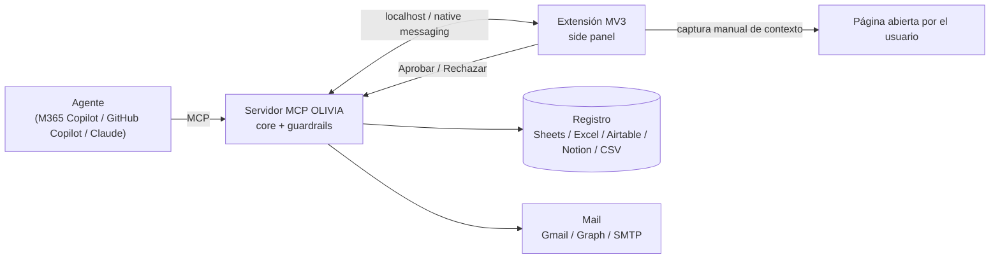
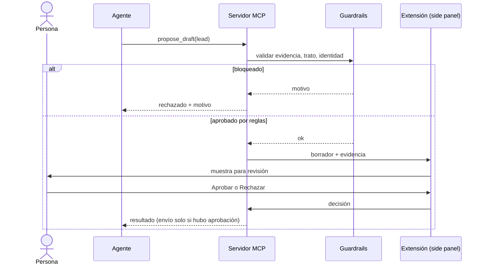
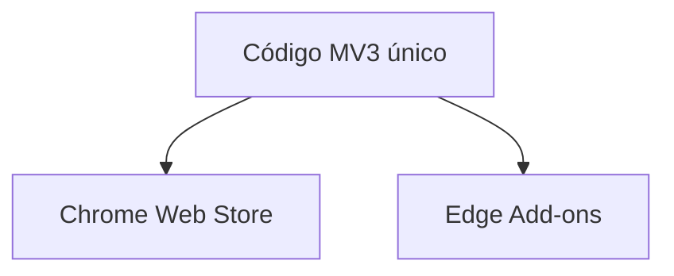

# Extensión de navegador (Chrome + Edge) y Copilot

Estado: propuesta para la iteración 2. La extensión es la **capa de aprobación y de contexto**; el core y los guardrails siguen en Python.

## Arquitectura

## Flujo de aprobación

## Chrome y Edge

Edge es Chromium: una sola base de código MV3 sirve para los dos. Cambia solo la publicación.

## Referencias

Los enlaces no se verificaron desde este entorno; confirmar antes de citarlos en un entregable.

**Extensiones**
- [Chrome: migrar a Manifest V3](https://developer.chrome.com/docs/extensions/develop/migrate)
- [Chrome: API Side Panel](https://developer.chrome.com/docs/extensions/reference/api/sidePanel)
- [Chrome: Native messaging](https://developer.chrome.com/docs/extensions/develop/concepts/native-messaging)
- [Chrome Web Store: publicar](https://developer.chrome.com/docs/webstore/publish)
- [Edge: extensiones basadas en Chromium](https://learn.microsoft.com/microsoft-edge/extensions-chromium/)
- [Edge Add-ons: publicar](https://learn.microsoft.com/microsoft-edge/extensions/publish/publish-extension)

**Copilot y MCP**
- [Model Context Protocol](https://modelcontextprotocol.io)
- [Copilot Studio: agregar servidores MCP](https://learn.microsoft.com/microsoft-copilot-studio/agent-extend-action-mcp)
- [VS Code: servidores MCP con Copilot](https://code.visualstudio.com/docs/copilot/customization/mcp-servers)
- [Microsoft Graph](https://learn.microsoft.com/graph/overview)

## Restricciones

- No hay evidencia de que Copilot dentro de Edge acepte extensiones de terceros como agente. La integración con Copilot va por MCP.
- La extensión solo captura contexto por acción manual del usuario en la página. No se automatiza la navegación ni la lectura masiva de LinkedIn. Ver `docs/COMPLIANCE.md`.
- El envío requiere siempre una aprobación humana explícita.
